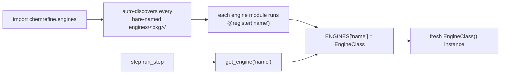

# Adding an Engine

ChemRefine's engines are a **self-contained plugin subsystem** under `chemrefine/engines/`.
chemrefine *declares* a small contract; an engine *provides* it. The whole subsystem is one
place:

- **the contract** — [`engines/api.py`](../api/engines_api.md): the `CalculationEngine` /
  `NmsCapableEngine` / `JobExecutable` Protocols, the DTOs, and the `ENGINES` registry. This is
  the only module the flat pipeline imports from `engines/`.
- **the reusable building blocks** (underscored — *compose*, never edit to add an engine):
  `_job.py` (`JobEngine`), `_execution.py` (the scheduler), `_script/` (`ScriptEngine`),
  `_backend_server/` (the ExtOpt server).
- **the plugins** — one bare-named package each, auto-discovered; the
  [engine table](../engines/index.md) lists what that currently is.

Adding an engine is **the engine's own files and nothing central**: a new bare-named
`engines/<name>/` package (auto-discovered — every bare-named subpackage is imported when
`chemrefine.engines` loads), its tests (`tests/test_engines_<name>*.py` and the fixture folder
`tests/data/engines/<name>/`), and its docs (a page under `docs/engines/` with its nav line, a
CHANGELOG bullet). You never edit a building block or a central list to make a new engine
exist, scaffold, document itself, or join the gates: every roster is derived from the registry,
and every per-engine verdict is read from the engine's own folder. Outside those, an engine
touches `pyproject.toml` when it needs a pip extra ([Resources](#resources)), and a list a
test module keeps by name where this guide asks for a line: the write gate's is one, for a
function that writes a file from inside its job ([Tests](#tests)).

## The steps

Adding an engine is the same handful of moves every time. Walk them in order — each has a section
below with the detail, and the [worked example](#worked-example-a-minimal-engine) at the end
strings them into one engine you can read top to bottom:

1. **Scaffold the package** — make `engines/<name>/` with `engine.py`, `options.py`, and an
   `__init__.py`.
2. **Pick a kind and write `engine.py`** — choose the base whose shape matches your backend
   ([Pick a kind](#pick-a-kind-and-provide-its-pieces)), decorate the class with
   `@register("<name>")`, declare its [ClassVars](#declare-the-metadata-classvars), and implement
   only the primitives that kind asks for.
3. **Validate the YAML knobs** in `options.py` ([Validate the YAML knobs](#validate-the-yaml-knobs)).
4. **Register it** — [one import line in *your own* `__init__.py`](#wire-registration); the
   package itself is auto-discovered.
5. **Wire resources** — a binary path or an optional `pip` extra ([Resources](#resources)).
6. **Support NMS** only if the engine computes frequencies ([Supporting NMS](#supporting-nms)).
7. **Add tests, a contract fixture and the knob verdict** ([Tests](#tests)).
8. **Document it on a page of its own** ([Documentation](#documentation)).

The sections that follow are those steps in detail.

## Pick a kind and provide its pieces

Decorate the class with `@register("<name>")` — a lower-case name: `engine:` is read in any
case and folded to lower case, so `register` refuses any other — and choose the **kind** that
matches the backend:

| Kind | Base | You provide |
|------|------|-------------|
| Per-structure program (own input format) | [`JobEngine`](../api/engines_job.md) | `build_input`, `run_block`, `parse_one`, `pal`, `gpus` + the ClassVars (`label` / `template_suffix` / `template_starter` / `output_suffix` / `output_globs`) |
| User Python script | [`ScriptEngine`](../api/engines_job.md) (a `JobEngine`) | `template_starter` (its `$OUTPUT_CONTRACT` line becomes the comment naming the output fields), `_vars_from` (inject `$VAR`s from `step.options`), and `output_fields` when the template reports more than the shared set (energy / geometry / gradient / `converged`); a field declared with `field=None` is kept in the raw JSON sidecar only |
| ORCA optimises using *this* engine's gradients | `ExtOptOrcaEngine` | the ClassVars `backend` / `wrapper_filename` / `options_cls` / `calculator_cls`, plus a `ComputeBackend` in `extopt_calc.py` |
| Not a per-structure job (e.g. a training step) | `CalculationEngine` directly | `prepare` / `submit` / `parse`, plus `artifact` + `run_dir` for `ArtifactEngine`, the `JobExecutable` members to run through the scheduler, and `label` / `template_suffix` / `template_starter` when it reads a template |

A `JobEngine` provides only **primitives** — the public provision surface chemrefine requests
(`build_input` / `run_block` / `parse_one` / `pal` / `gpus`, the `JobExecutable` contract). The
base owns the lifecycle: `submit` delegates to `engines._execution.run_batch` (the scheduler),
and `parse` feeds `build_structures`, which mints child IDs + lineage. Every `JobEngine`
*templates* — ORCA's input is a `.inp`, a `ScriptEngine`'s is a `.py`; that's the `build_input`
step, not an engine-specific feature.

## Declare the metadata ClassVars

`name`, plus the base-required ClassVars (`label`, `template_suffix`, `output_suffix`,
`output_globs`), as `ClassVar[...]` annotations matching the other engines. Two more travel
with the engine rather than with any central list: `template_starter`, the text
`chemrefine scaffold` writes for a missing template (every template-driven engine declares
one; see [`TemplateDriven`](../api/engines_api.md)), and — only if the engine takes the
`check_step` hook, or the `check_template` hook for rules about what its template says —
`preflight_refuses`, one sentence naming what the hooks refuse
([`PreflightChecking`](../api/engines_api.md), [`TemplateChecking`](../api/engines_api.md);
the invariants hold the sentence unrepeated across engines). The run's t=0 walk asks both
before any step runs, and `chemrefine validate` reports their refusals. Every action that may
submit runs that walk first, so `prepare` does not ask `check_step` again; it asks
`check_template` again on its own read of the template, so an edit made after the run started
meets the same rule. `register` refuses an engine that declares part of a capability — a
template engine without its starter, a hook without its sentence — because a capability taken
in part is not detected at all. There is no `supports_nms` flag — NMS is a *capability*
(below), detected via `isinstance`.

## Validate the YAML knobs

Add a Pydantic model in `engines/<name>/options.py` subclassing
[`EngineOptions`](../api/engines_api.md) (it carries the shared `device` / `cores` /
`backend_python` fields + frozen / `extra="forbid"` config + `from_raw`); add your own
fields and read it in the primitives. This
keeps `step.options` a free dict at the orchestrator level while giving the engine typed
validation. Every field is part of the cache key, so changing it re-runs the rows it reaches
— except a field that chooses where or how the job runs rather than what it computes (a rank
count, a timeout), which you declare `Annotated[..., UNKEYED]` so raising it over a finished
step stays a cache hit; the base's `cores` and `backend_python` already are.

## Wire registration

Registration is an **import side effect** of `@register("<name>")`, and discovery is automatic:
importing `chemrefine.engines` imports every bare-named subpackage under `engines/`. The only
wiring you write is inside your own package — import the class in `engines/<name>/__init__.py`
so the discovery import runs your decorator:



```python
# engines/<name>/__init__.py
from chemrefine.engines.<name>.engine import MyEngine

__all__ = ["MyEngine"]
```

Registering changes nothing outside `engines/<name>/` — underscored packages (building
blocks) and plain modules are never treated as plugins, and core names no engine (it
describes one by its role, which `tests/test_package_boundaries.py` holds). Legacy YAML engine
spellings are rewritten to the canonical name by `config_legacy.normalize` (the single place
that knows the legacy vocabulary) — never the registry.

## Resources

An external binary reads its path from `ctx.executables.get("<key>")`, a key the engine
declares in `executable_keys` (`ExecutablesDeclaring`): the GUI suggests the declared keys, the
engine table lists them, and a test holds every key an engine package reads to its
declaration. An importable backend
ships as a `pip install chemrefine[<name>]` extra and is imported **lazily** (inside the function
that needs it) so the package imports cleanly when the optional dependency is absent — declare
the extra + pip package + import name at registration so a missing library reports the extra to
install (see `mlip.registry.MlipLibrary` — one declaration per library, shared by its
calculator and its trainer).

The extra is the one thing an engine declares outside its own files. Add it under
`[project.optional-dependencies]` in `pyproject.toml` — `test_every_backend_extra_is_declared_in_pyproject`
fails until you do, because an extra nothing installs provisions an empty environment that then
dies on the backend import. If the library supports only some Python versions, put a
`python_version` marker on every requirement of the extra and record the supported versions in
`test_provision.py`'s `capped` table; if its modules ship no type stubs, list them under mypy's
`ignore_missing_imports` overrides in the same file. The install page's extras table and the
backends table are generated from what you declared.

## The lifecycle

Whatever kind you pick, the engine satisfies the contract the step lifecycle drives in order.
That contract is three methods and mentions caching nowhere: how a run is resumed is the
orchestrator's business, not an engine's. `submit` blocks until the jobs finish, so there is no
separate `wait`:

```
prepare → submit → parse
```

## Supporting NMS

Normal-mode sampling is **engine-independent**: the two-round algorithm lives in
`chemrefine.nms`. NMS is a capability, not a flag — implement the
[`NmsCapableEngine`](../api/engines_api.md) Protocol's hook and sentence and populate three
structure fields; capability is detected with `isinstance`:

- `nms_input_info(ctx) -> NmsInputInfo` — introspect the step's input (is it a TS search? does it
  compute frequencies?), driving the default target and the freq gate.
- `frequency_request` — how your input asks for frequencies, as a user writes it. The refusal
  of an `nms: true` step whose input asks for none quotes it, so name only spellings
  `nms_input_info` counts; a test feeds each one to it.
- set `frequencies` (every vibrational mode → cm⁻¹, translations and rotations left out),
  `imaginary_freqs` (its imaginary subset) and `normal_modes` (the displacement tensor, indexed
  by the same mode indices) on each parsed `Structure`, in the *same* pass that reads
  geometry/energy — NMS reads them off the structure, so there is no separate output-reading
  hook and the file is parsed once. Which modes are translations and rotations is the engine's
  to say: `random` sampling draws from the `frequencies` keys.

Everything else — displacement, round-2 submission, resolution, retry — is generic.

An NMS-capable engine also implements the [`FrequencyOutputParsing`](../api/engines_api.md)
hook (`parse_frequency_output`) — the ctx-free re-parse the mode-viewer tools use on a
finished step; the invariant suite holds the two capabilities together.

The second bullet is a `JobEngine`'s own `parse_one` to satisfy, which is why ORCA and Q-Chem
do. A `ScriptEngine` parses through the shared reader instead, so it reports what its
[output contract](#the-parsed-result-contract) declares: add the two fields to its
`output_fields` and have the template assign them. Until it does, `nms: true` on a script step
is ignored with a warning from `chemrefine validate` — the capability is detected, not
assumed.

## Parsing output that depends on the input

Some programs write different sections depending on what was computed — an `opt` repeats its
energy every cycle, an ensemble generator emits many geometries, a correlated method prints
more than one total energy. The shipped reference for handling that is `orca/`, and the shape
is worth mirroring because it keeps the input→output coupling in one explicit chain instead of
scattered through the parser:

- **`inspect.py` parses the template's text, handed to it once, into a frozen `InputInfo`** —
  which keywords ran, is it a TS search, does it compute frequencies. The engine reads the
  file through `require_template` and hands the inspector its text; nothing else re-derives
  facts from the template.
- **An explicit `operation:` wins; otherwise the inspection decides** (ORCA:
  `OrcaEngine.infer_operation`). Declare it as `OperationInferring` and the step resolves
  its operation once, onto `StepContext.operation`: the cache keys the operation the outputs
  are read as, not its spelling, and `parse_one` reads it off the context instead of the
  template. Its `reads_alike` says which operations your parser dispatch reads the same
  way, so a declared operation is warned about only when it reads the outputs unlike what
  the template runs; a contract-fixture test holds it to real parses. If the vocabulary is
  real, declare `OperationsDeclaring`, its names lower case
  with `_` — the run's t=0 walk and `chemrefine validate` then refuse an explicit operation
  outside it, with no `check_step` of the engine's own, and the schema document and agent
  guide serve the vocabulary with no further wiring. An inferred operation outside it still
  runs, each output read as its final structure, and the run says so once, when it starts.
- **A read-once coordinator hands shared text to per-section extractors** (see
  `orca/output/`: coordinator / energy / geometry / frequencies / status) — the file is read
  once, and each section owns its own block grammar.
- **The disciplines**, held by the contract goldens and the recorded-output sweep: *last
  match wins* (an `opt`'s repeated prints resolve to the final one); *finite refusal at the
  boundary* (a value that cannot be read raises `OutputParseError`, an abnormal ending
  `OutputTerminationError` with the `.err` tail — never a silent `NaN`); and every case ships
  a *trimmed real* contract fixture. A file the filesystem will not let the run read is
  not yours to word: let the `OSError` of your read leave `parse_one`, and the lifecycle
  files it as that structure's `unreadable` failure, the same for every engine. And *a
  verdict is read, never assumed*: set `terminated_normally` and `converged` only from
  what the output itself says of how the program ended. Left unset, a structure is held
  to its job's own account — a job script that exited non-zero, or was cut down before
  it could say, fails it — where a flag set to `True` without reading would vouch for a
  program that died after printing an energy and a geometry.

For **method-dependent scalars** — "the" energy differs between a plain SCF and a correlated
run that prints both — declare a priority chain over the *output text*: rows tried highest
level of theory first, the first whose pattern matches wins, each row at its own first/last
occurrence policy. Selection is by evidence in the output, never by inspecting the input to
pick a parser: whichever method actually ran left its line.

Parsing stays **per-engine** on purpose: the formats genuinely differ, and the shared ground
is the [`ParsedResult` contract](#the-parsed-result-contract) with its goldens, plus the
extracted seams — `NmsInputInfo`, `OperationsDeclaring`, `FrequencyOutputParsing`. A new
engine mirrors the *shape* above without importing a line of another engine's parser.

## Tests

Add `tests/test_engines_<name>*.py`, mirroring the existing engine tests. New code ships at 100%
line+branch coverage with a docstring on every public symbol.

The suite is tiered: unit tests (hermetic), **recorded** end-to-end tests that replay real
outputs without any binary installed, and **live** integration tests (`pytest -m integration`,
deselected by default) that run the real binaries and re-record the fixtures with `--record`.

A new engine also brings **one small live case** under `tests/data/e2e/cases/<name>/` — the
smallest system and the fewest jobs that exercise its own seam, since behaviour every engine
shares (NMS, `on_failure`, retries, recovery) is already proven once on ORCA with xTB. The
case is its `input.yaml`, templates and seed, plus a `case.yaml` declaring its `budget_s`
(and `heavy: true` if its load cannot be made small), and a `CHECKS` entry in
`tests/test_e2e_replay.py` stating what it proves. Record it with `pytest -m integration
--record`; the live run is replayed from its own pack before it may replace a recording. Until
the case exists, `test_every_engine_library_and_trainer_runs_live_in_some_case` fails — or
excuse the engine in `NOT_LIVE` with the reason it cannot run on the recording machine.

An engine whose job runs this package's own Python — a server, a bridge, a trainer's
loop — and writes a file there names that function in `_RAW_WRITERS`
(`tests/test_package_boundaries.py`), with one line saying what it writes. The write gate,
`test_the_run_tree_is_written_only_through_io`, reads a raw write anywhere outside
`chemrefine.io` as the orchestrator's until a line says whose it is, so it fails until the
function is listed. A write the orchestrator makes gets no line: it goes
[through `chemrefine.io`](#worked-example-a-minimal-engine).

### The parsed-result contract

Every engine's parse lands in one canonical, engine-independent record —
`chemrefine.cache.structure_record` is the normative schema (energies in Hartree, forces in
eV/Å, positions in Å, run-status flags, string-keyed imaginary modes). The pipeline writes it
as `step{N}_{id}.result.json` beside every parsed output, whatever native format the backend
produced.

A new engine **must ship at least one contract case** under
`tests/data/engines/<name>/<case>/`: a *shortened real* native output (trim it to the blocks
your parser reads), the seed geometry (`step1_0_inp.xyz`), a `case.json` meta, and the golden
`expected.json`. Generate the golden with

```bash
pytest tests/test_engines_contract.py --update-goldens
```

and review the diff. The suite fails until every registered engine ships a case
(`test_every_registered_engine_ships_a_contract_case`).

Beside the cases, an engine that declares an options model files its **knob verdict** as
`tests/data/engines/<name>/knobs.json`: `"model"` names the options class, `"examples"` the
knobs a shipped example must demonstrate, `"tests_only"` the rest (a `"note"` may say why).
Every field of the model belongs to exactly one list — `test_knob_universe_is_fully_filed`
fails until it does — and engines sharing a model (`mlip` / `mlip-extopt`) file it once.

Guards for the mutation gate go beside them too, optionally:
`tests/data/engines/<name>/mutations.json` is a JSON array of entries with the fields of
`scripts/mutation_gate.py`'s `Mutation` (`id`, `path`, `old`, `new`, `tests`, `breaks`), run
after the bundled list and checked for stale anchors like any other entry.

## Documentation

An engine documents itself on a page of its own, `docs/engines/<name>.md`, and adds its nav
line to `mkdocs.yml` (a page without one fails `mkdocs build --strict`). The drift guard
(`test_docs_drift`) looks for that page before the shared engines page, so every field of the
options model must be named on it, and the generated engine table links the engine's row to
the page the moment the file exists. The engine, backend and extras tables are generated from
the registry and `pyproject.toml` — nothing to type. What is still yours to write: the page,
a CHANGELOG bullet, and a row in `examples/README.md` if an example ships.

## Worked example: a minimal engine

To see the steps as one unit, here is a complete *illustrative* engine — `demoqm`, a fictional
quantum-chemistry program with its own `.inp` format and a `demoqm` binary. It's a `JobEngine`
(one job per structure, its own input file). This code is **not shipped** — don't look for
`engines/demoqm/` — but every signature matches the real base, so it reads exactly like the
shipped `orca/`.

The package is three files:

```text
engines/demoqm/
  __init__.py     # registration import
  engine.py       # the engine + its primitives
  options.py      # the YAML knobs
```

**Step 1 + 3 — `options.py`** validates `step.options`, reusing the shared fields and
frozen config from `EngineOptions`:

```python
from __future__ import annotations

from pydantic import Field

from chemrefine.engines._options import EngineOptions


class DemoqmOptions(EngineOptions):
    """Validated ``step.options`` for the demoqm engine."""

    basis: str = Field("sto-3g", min_length=1)
    """Orbital basis set, written into the input."""
```

**Step 2 — `engine.py`** picks `JobEngine`, declares the ClassVars, and implements only the
per-structure primitives (`prepare` / `submit` / `parse` come from the base — you don't write them):

```python
from __future__ import annotations

from pathlib import Path
from typing import ClassVar

from chemrefine.engines._job import JobEngine
from chemrefine.engines.api import ParsedResult, RunBlock, register
from chemrefine.engines.demoqm.options import DemoqmOptions
from chemrefine.ids import StepTemplate
from chemrefine.io import write_tree_file
from chemrefine.state import StepContext


@register("demoqm")
class DemoqmEngine(JobEngine):
    """Illustrative QM engine: runs the ``demoqm`` binary once per structure."""

    name: ClassVar[str] = "demoqm"
    label: ClassVar[str] = "DemoQM"
    template_suffix: ClassVar[str] = "inp"  # input-file extension
    template_starter: ClassVar[str] = (
        "# DemoQM starter: set the method; $BASIS and $XYZ are filled per structure.\n"
        "basis $BASIS\ngeometry $XYZ\n"
    )
    output_suffix: ClassVar[str] = "out"  # output-file extension
    output_globs: ClassVar[tuple[str, ...]] = ("*.out",)
    executable_keys: ClassVar[tuple[str, ...]] = ("demoqm",)  # what run_block reads

    def build_input(
        self,
        *,
        xyz_path: Path,
        template: StepTemplate,
        input_path: Path,
        output_path: Path,
        ctx: StepContext,
    ) -> None:
        """Render this structure's ``.inp`` from the step template + its geometry."""
        opts = DemoqmOptions.from_raw(ctx.step_cfg.options)
        write_tree_file(
            input_path,
            template.text.replace("$BASIS", opts.basis).replace("$XYZ", xyz_path.name),
        )

    def pal(self, ctx: StepContext) -> int:
        """Cores per job, before the scheduler clamps it to ``max_cores``."""
        return 1

    def run_block(self, ctx: StepContext, inp_path: Path, out_path: Path) -> RunBlock:
        """The bash that runs inside the job's work dir."""
        demoqm = ctx.executables.get("demoqm", "demoqm")
        return RunBlock(body=f'{demoqm} {inp_path.name} > "$OUTPUT_DIR/{out_path.name}"')

    def parse_one(
        self, output_path: Path, structure_id: str, ctx: StepContext
    ) -> list[ParsedResult]:
        """Parse one ``.out`` into a ``ParsedResult`` (return ≥2 to fan out to an ensemble)."""
        text = output_path.read_text(encoding="utf-8", errors="replace")
        # your regexes; cf. engines/orca/output/
        symbols, positions, energy = _read_demoqm_out(text)
        return [
            ParsedResult(
                symbols=symbols,
                positions=positions,
                energy_hartree=energy,
                forces_ev_per_a=None,
            )
        ]
```

Everything an engine writes in the orchestrator's process — `build_input`'s file, a
`CalculationEngine`'s `prepare` and `parse`, an MLIP trainer's `write_split` — goes through
[`chemrefine.io.write_tree_file`](../api/io.md), never `Path.write_text`, or runs inside
`with chemrefine.io.tree_write(path):` where a library does the writing (ase, numpy, sqlite
through `ase.db`), so a write the output tree refuses stops the run as `OutputTreeError`,
[exit `11`](../running/when-a-run-fails.md#exit-codes), naming the file, the same for every
engine. `test_the_run_tree_is_written_only_through_io` holds it over the whole package; a
function the job runs writes its own files, and is [listed by name](#tests).

`gpus` defaults to `0` (CPU); a GPU engine overrides it.

**Step 4 — register** with your own `__init__.py` — the bare-named package is auto-discovered,
so registering changes nothing outside `engines/demoqm/`:

```python
# engines/demoqm/__init__.py
from chemrefine.engines.demoqm.engine import DemoqmEngine

__all__ = ["DemoqmEngine"]
```

That's a working engine: `engine: demoqm` in a step now renders `step{N}.inp` per structure, runs
`demoqm`, and parses each result back into the pipeline.

For the real, shipped versions to copy: **`qchem/`** is the closest to the engine above — a
`JobEngine` wrapping a program with its own input format, and nothing else; **`orca/`** is the
same kind carrying the ExtOpt and NMS machinery too; **`pyscf/`** is a `ScriptEngine` (it
overrides only `_vars_from`); **`mlip/`** adds a backend server.

Pick by how the calculation is reached, not by what it computes: a program with its own
input format is a `JobEngine` like the one above; a Python library is a `ScriptEngine`
(chemrefine renders a `step{N}.py` that imports it) or a `_backend_server` backend (ORCA
drives it over the ExtOpt bridge) — never a binary wrapper.

## Adding an MLIP backend

A new MLIP *library* is not a new engine — the `mlip` / `mlip-extopt` / `mlip-train` engines
drive whichever backends the registry knows. One dropped-in module under
`engines/mlip/backends/`, auto-discovered like the engine packages, declares the library once
and hangs its capabilities off it:

```python
from chemrefine.engines.mlip.registry import CalculatorSpec, MlipLibrary

MY_MLIP = MlipLibrary(extra="mlip-my_mlip", package="my-mlip-lib", import_name="my_mlip_library")


@MY_MLIP.calculator("my_task")
def _build_my_mlip(spec: CalculatorSpec):
    from my_mlip_library import MyCalculator  # imported lazily, inside the builder

    return MyCalculator(model=spec.weights or spec.model_name, device=spec.device)


@MY_MLIP.trainer("my_task")  # optional — omit if the library cannot train
class MyTrainer(TrainerBase): ...  # or ApiTrainerBase, for API-driven libraries
```

A trainer run through its library's own CLI (`TrainerBase`) also declares
`start_placeholders`: for each start a step can name (`weights_path` for a `model_path`
checkpoint, `foundation` for a release), the placeholders its config can carry it through.
A step starting from a model is then refused a template that references none of them, and
the registry refuses a `TrainerBase` that declares no mapping. An `ApiTrainerBase` inherits
an empty one, because its start rides the shared driver's command line.

A library whose loaders take a fixed set of named models declares them as
`MlipLibrary(..., releases={"my_task": {"small": "small"}})`, by `task_name`: each maps the
name a step writes as `model_name` to the one the library's trainer reads it by. Every MLIP
step's `model_name` is then held to that set before the run starts, and the backend table
lists it. A task left out takes `model_name` as the library's open vocabulary.

These obligations live outside the module, each enforced by the suite:

- **The pyproject extra.** Declare `mlip-my_mlip` under `[project.optional-dependencies]` —
  `test_every_backend_extra_is_declared_in_pyproject` fails until you do, because an extra
  nothing installs provisions an empty environment that then dies on the backend import. If
  the library supports only some Python versions, put a `python_version` marker on every
  requirement of the extra and record the supported versions in `test_provision.py`'s
  `capped` table.
- **Fake-module tests for the builder.** The registry imports every backend module at
  discovery, so the heavy import must stay inside the builder (an AST scan asserts it); test
  the builder by planting fake modules in `sys.modules` — the `_install_fake_*` pattern in
  `tests/test_engines_mlip_calculator.py`.
- **The write gate's line, for an `ApiTrainerBase`.** `train_with_library` runs inside the
  training job and saves the model there, so the method is one the write gate lists by name
  ([Tests](#tests)): `test_the_run_tree_is_written_only_through_io` fails on a writer it
  knows — `torch.save` is one — until it is.

The registry-derived gates do the rest with no edit: the missing-dependency test tries your
tasks and expects the install hint naming the package and extra, the trainer-contract
invariants parametrize over `registered_trainers()`, and `chemrefine backends` lists the new
environment.

### Adding a calculator knob

The calculator surface is deliberately **closed**: `CalculatorSpec` is frozen with no
catch-all `**extra`, so a knob no field names has nowhere to hide, and no builder can
silently swallow a knob the dispatch passes. The price is that a new knob is declared in
four places, each visible and typed:

1. `mlip/options.py` — the field on `MlipOptions`, and its name appended to
   `CALCULATOR_KNOBS`.
2. `mlip/registry.py` — the matching `CalculatorSpec` field (a builder that ignores it
   ignores it *visibly*).
3. `mlip/calculator.py` — thread it through `build_calculator` into the spec, and keep it on
   `MlipCalculator.__init__`.
4. `mlip/extopt_calc.py` — accept it in `MlipExtOptCalculator.__init__` and forward it.

Everything downstream derives from `CALCULATOR_KNOBS` and the model: the direct engine's
`$KNOB` template placeholder, the ExtOpt server's `--knob` CLI flag (with the model's own
default), and the server reading it back off the parsed args — no further edits.

See the [Engine Contract & Registry API](../api/engines_api.md) for the exact signatures, and
[Architecture & Code Flow](../internals/architecture.md) for where the lifecycle sits in the run.
