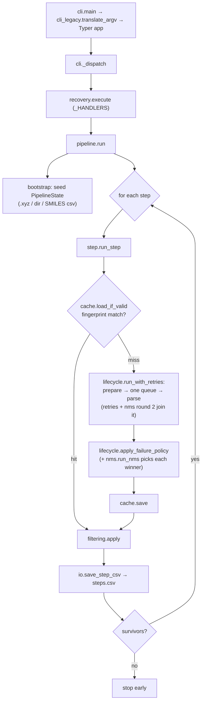
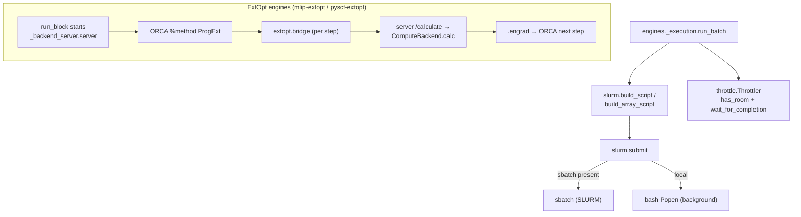
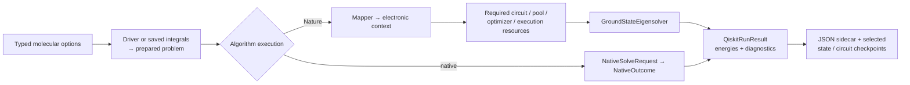

# Architecture & Code Flow

ChemRefine is layered one-directionally: the CLI dispatches a recovery action,
the pipeline iterates steps, each step drives an engine through a fixed lifecycle,
and the engine submits jobs through the SLURM/throttle machinery. State flows
forward as immutable `PipelineState` values.

Three ideas shape the rest, and everything below is a consequence of one of them:

- **Immutable state threading.** Each step receives the previous step's survivors as a
  frozen `PipelineState` and returns a new one — there is no mutable shared god-object.
- **Engine plugins behind a Protocol.** The orchestrator only ever sees the
  `CalculationEngine` contract and a name→class registry; no concrete engine is imported
  by the core. See [Adding an engine](../developer/adding-an-engine.md).
- **Fingerprint-cached steps.** A step re-runs only when its config or its parent
  structures change. See [Caching & resume](../running/caching.md).

## Module layering

```
cli → recovery → pipeline → step → {cache, filtering, input_files}
                                  → nms (a peer of step, not a leaf under it:
                                         it drives its own two rounds through
                                         lifecycle, cache, attempts, filtering, io)
                                  → lifecycle (run → classify → policy → persist → cache)
                                       → attempts (attemptK/ directories)
                                  → engines.api (Protocols + ENGINES registry)
                                       → engines/<name>/ (one package per plugin)
                                            → engines/{_job, _execution, _script} (building blocks)
                                            → slurm, throttle, io, ids, quantities, state, config
```

`config` and `state` sit under everything and are drawn nowhere above because nearly
everything reads them: `state` is the vocabulary every layer passes (most modules in the
package import it, engines included) and `config` the one it is specified in. Neither imports anything above itself,
which is what makes the direction hold.

The spine is one-directional but not a strict ladder — three edges skip a rung, each
deliberately. `recovery` reaches `cache` directly (to discard a step's state before running
one) and `step` directly (for the `RunPlan` / `StepMode` vocabulary a recovery action is
written in); `pipeline` reaches `filtering` (the per-step CSV must summarise the same energy
the step filtered on) and `slurm` (the `dispatch:` preflight). `job_log` is written by
`slurm/script`, not by an engine.

**`engines/` does not import `cache`** — an engine turns a step's specification into a
calculation and the output back into structures; how a run is resumed and what a cache key is
made of are not its business. The step's template travels on the `StepContext` and the cache
digests it from there, so no engine has to hand the cache anything.
`test_no_engine_module_imports_the_cache` keeps the boundary honest, since prose does not.

`sbatch` / `squeue` are reached only from `slurm`; `io` and `cache` own the *shared* on-disk
formats (each engine owns its own input format — that is the plugin contract). Engines
receive a focused `StepContext`, never the whole `Config`.

`input_files` resolves file-valued engine options relative to the configuration
directory and joins them with engine-declared manifest dependencies. It preserves
the written references for portable fingerprints while workers receive absolute
paths. The engine interprets its own bundle format; the cache hashes the resulting
named files. Inputs produced by earlier steps need not exist during dry-run, but
must be readable when the consuming step prepares work. See
[Declared Input Files](../api/input_files.md).

## Entry points

The user-facing pipeline and its worker entry points have separate process lifetimes:

| Entry point | Started by | What it is |
| --- | --- | --- |
| `chemrefine` (`cli:main`) | the user | the pipeline; the only one that reads `sys.argv` for a *run* or sets its exit code |
| `python -m chemrefine.engines._backend_server.server` | an ExtOpt step's job script | the gradient server ORCA's wrapper posts to |
| `chemrefine.engines.orca.extopt.bridge` | ORCA, via `%method ProgExt` | relays one `.extinp.tmp` to that server and writes back `.engrad` |
| rendered Qiskit molecular script | a `qiskit` step's job script | calls `workflow.run_job` in the selected backend interpreter |
| rendered quantum experiment script | a `qiskit-experiment` step's job script | calls `experiment.run_experiment` and publishes one native artifact |
| `python -m chemrefine.engines.qiskit.cutting_worker` | the circuit-cutting planner | constructs cutting experiments in an isolated, bounded subprocess |

The ExtOpt server runs once per step job; ORCA invokes its bridge for each gradient
request. Quantum scripts run in scheduled workers, and the cutting subprocess
exits when planning finishes. Separate programs parse their own argv without
moving pipeline decisions into those workers.

## The recovery matrix

Every CLI action resolves, once, to a `RunPlan`: a default `StepMode` for the
pipeline plus per-step overrides. `pipeline.run` then asks `plan.for_step(n)` and
`step.run_step` acts on the answer — nothing re-derives it further down.

| Action | Cache invalidated first | Plan | What each step does |
| --- | --- | --- | --- |
| `run` | every step | default `EXECUTE` | every step re-runs its engine |
| `resume` | none | default `RESUME` | caches are honoured; the pending `on_failure: stop` step has its failures re-attempted |
| `rerun [N]` | step N (default: last) | default `RESUME` | step N misses its cache and re-executes end to end; the rest resume, so one whose fingerprint no longer holds re-executes too |
| `rebuild-nms [N]` | none | default `CACHE_ONLY`, `{N: REBUILD}`, `stop_after=N` | the same rebuild as `rebuild-cache`, but N defaults to the step setting `nms: true` rather than the last |
| `rerun-errors [N]` | none | default `CACHE_ONLY`, `{M: RESUME for M >= N}` | step N re-attempts its pending failures; earlier steps are served from cache and cannot halt the run before N is reached; later steps resume, having never run |
| `rebuild-cache [N]` | none | default `CACHE_ONLY`, `{N: REBUILD}`, `stop_after=N` | step N is re-parsed from the outputs already on disk and its cache rewritten — no submission; the steps after N are then re-reported from their caches, best-effort, stopping quietly at the first one the configuration can no longer serve |

The four modes:

| `StepMode` | Cache | Pending `stop` failures | Submits? |
| --- | --- | --- | --- |
| `EXECUTE` | ignored | n/a | yes |
| `RESUME` | honoured | re-attempted | only for the failures |
| `CACHE_ONLY` | honoured | left alone | no |
| `REBUILD` | rewritten | re-derived from disk | no |

`rerun` needs no mode of its own: invalidating the target's cache is enough to make
it miss and execute. The mapping is asserted end to end by
`test_recovery_matrix` — that test is the specification, and a new `Action` has to
be given a row in it.

## Run flow

What happens when you run `chemrefine run input.yaml`:



## Submit / compute flow

A `JobEngine`'s `submit` delegates to `chemrefine.engines._execution.run_batch`, which
generates jobs and throttles them against the CPU+GPU budget using the engine's
primitives (`run_block` / `pal` / `gpus` / `output_globs`). The ExtOpt engines
additionally stand up a gradient server that ORCA talks to per optimisation step:



## Key types

- `PipelineState` — the tuple of `Structure` survivors threaded between steps.
- `Structure` — one geometry plus energy / forces / status flags; carries its
  `parent_id` so lineage (and `by_parent` filtering) is explicit.
- `StepContext` — the per-step input bundle handed to an engine.
- `StepInputs` / `JobBatch` / `StepResults` — the engine lifecycle hand-offs.

See the [API Reference](../api/index.md) for the full contracts.

## Qiskit computation and artifacts

The Qiskit package registers two engines behind the same orchestration contracts.
`qiskit` is a `ScriptEngine` for per-structure single-point energies.
`qiskit-experiment` implements `ArtifactEngine` and schedules one experiment whose
scientific output is a bundle; the input structures pass through unchanged.
Neither provides gradients, geometry optimization, frequencies, or normal-mode
sampling.

Molecular preparation is independent of solving. A PySCF driver or a validated
`ElectronicStructureData` integral input supplies the electronic problem;
freeze-core and active-space transformations record their energy offsets.
Nature algorithms map the prepared problem and assemble the required components.
Native fermionic algorithms receive `NativeSolveRequest` and can solve the
prepared Hamiltonian without mandatory Pauli mapping. Reporting restores scalar
offsets exactly once and exposes the electronic or total energy convention.



The component registries carry strict option models, capabilities, resource
requirements, execution modes, and optional backend requirements. Preflight and
managed-environment selection follow the same declarations, including transitive
dependencies such as a sampler used by QNSPSA. Estimator and sampler resources own
their session cleanup and optional transpilers. Registry discovery stays SDK-free;
provider objects are constructed only inside the selected worker.

Quantum bundles are engine-native outputs: a JSON descriptor names a hashed NPZ
payload and records array shapes, types, and scientific provenance. Integral,
state, tensor-factor, circuit, and experiment outputs reuse this container.
Descriptors are published after their payloads, and local output validators check
integrity and the selected product during completion, cache consumption, and
rebuild. Bound-circuit payloads contain QPY data; SDK deserialization occurs in
the selected worker rather than in generic cache handling.

`checkpoints/` and `provider_jobs/` are preserved through job scratch cleanup.
Checkpoints support scientific replay; provider journals record submission intent
and returned identifiers. Ordinary cache recovery validates local outputs without
retrieving or submitting remote jobs. These records do not serialize optimizer
state or make interrupted variational calculations automatically resumable.

See [Qiskit Engines](../api/engines_qiskit.md),
[Quantum data handoffs](../engines/qiskit-handoffs.md), and
[Quantum provider recovery](../engines/qiskit-recovery.md) for the public interfaces
and recovery boundaries.
